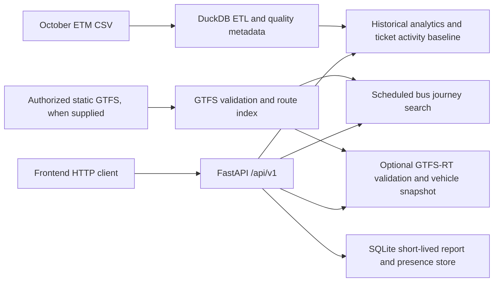

# CrowdWise backend handoff for frontend developers

**Audience:** the separate CrowdWise frontend team. This document describes the backend contract and real data availability. It does not assume a current GTFS feed or live vehicles are available.

## 1. What the backend does

CrowdWise provides historical analytics over a locally supplied October 2026 ETM export, a GTFS Schedule importer/router that activates only for quality-approved feed data, and backend services for short-lived community crowd reports and opt-in near-stop signals. A GTFS-Realtime VehiclePositions adapter is implemented but only polls after an operator-authorized URL is configured. A short-horizon ticket-activity baseline exists with a freshness gate.

Historical ETM `created_at` is transaction time, not verified boarding time. ETM start/end values are labels, not reviewed physical stops or confirmed alightings. ETM counts do not establish queue size or onboard occupancy. CrowdWise currently has **no authorized current Delhi GTFS or GTFS-RT feed, no APC/manual load ground truth, and no vehicle capacity map**. Thus route search/live vehicle/presence geofencing are unavailable in the current local setup; do not manufacture alternatives.

## 2. Architecture



- Python 3.11+, FastAPI, Pydantic and DuckDB. GTFS-RT protobuf parsing uses MobilityData `gtfs-realtime-bindings`.
- ETM analytics read from `CROWDWISE_DATABASE_PATH` (default `datasets/processed/crowdwise.duckdb`). The API opens it read-only per request.
- Community reports, opt-in signals and current RT snapshot/health use a separate local SQLite file (`CROWDWISE_COMMUNITY_DB_PATH`, default `datasets/community/crowdwise_signals.sqlite3`). Keep it on persistent writable storage; do not replace the historical DuckDB.
- The Uvicorn lifespan starts an RT poller only when a feed URL is set and always starts expiry cleanup. Missing URL/key does not prevent application startup.

## 3. Install, data setup and run

PowerShell from the project root:

```powershell
py -3.12 -m venv .venv
.\.venv\Scripts\Activate.ps1
python -m pip install -r requirements.txt
python -m pip install -r requirements-dev.txt
```

The repository expects its private ETM CSV at `datasets/etm/raw/October-Delhi.csv`. If supplied, rebuild/query tables:

```powershell
python -m scripts.process_etm --csv datasets/etm/raw/October-Delhi.csv --database datasets/processed/crowdwise.duckdb
```

Run the API:

```powershell
python -m uvicorn app.main:app --host 127.0.0.1 --port 8000
```

Base URL: `http://127.0.0.1:8000`; API base: `http://127.0.0.1:8000/api/v1`. For another machine/container, bind to `0.0.0.0` and configure network/security appropriately. Swagger UI: `/docs`; generated schema: `/openapi.json`.

GTFS is opt-in and must be acquired lawfully. Place it at `datasets/gtfs/raw/delhi_buses_static_gtfs_v1.zip`, then run `python -m scripts.process_gtfs --zip datasets/gtfs/raw/delhi_buses_static_gtfs_v1.zip --database datasets/processed/crowdwise.duckdb`. Review `outputs/gtfs_validation.json`; capability becomes active only when the quality gate passes and the requested service date is in range.

## 4. API inventory

There are 30 business paths. Full Pydantic schemas, examples, errors, source and availability are in [API endpoint catalog](api-endpoint-catalog.md); use live `/openapi.json` as the exact deployed schema.

| Group | Method and path | Availability/meaning |
|---|---|---|
| System | `GET /health`, `GET /ready` | Liveness and ETM readiness. |
| System | `GET /api/v1/system/capabilities` | Discover enabled data/features before rendering or calling optional paths. |
| System | `GET /api/v1/system/datasets`, `GET /api/v1/system/methodology` | Provenance and methodology text. |
| Historical | `GET /api/v1/analytics/overview` | ETM quality/coverage summary. |
| Historical | `GET /api/v1/analytics/trends?granularity=day|week` | Recorded passenger volume and transaction counts. Optional `date_from`, `date_to`. |
| Historical | `GET /api/v1/analytics/peak-hours?day_type=all|weekday|weekend` | Ticket transaction-time profiles. |
| Historical | `GET /api/v1/analytics/corridors?limit=20` | Highest source route-label activity. Optional date filters. |
| Historical | `GET /api/v1/analytics/service-profile` | Source `is_ac`/`ticket_type_id` summaries; semantics unverified. |
| Stops | `GET /api/v1/stops?q=...&source=auto|etm|gtfs&limit=...&offset=...` | Current local `auto` uses ETM labels because no GTFS is loaded. |
| Stops | `GET /api/v1/stops/{stop_id}` | ETM label summary or a GTFS stop; no automatic mapping. |
| Stops | `GET /api/v1/stops/{stop_id}/demand` | Historical ticket-start proxy, not a waiting count. Supports date, route, weekday/hour and paging filters. |
| Stops | `GET /api/v1/stops/map?south=...&west=...&north=...&east=...` | Requires usable GTFS stop coordinates; currently 503. |
| Routes | `GET /api/v1/routes?q=...&limit=...&offset=...` | Historical ETM route labels, not canonical service IDs. |
| Routes | `GET /api/v1/routes/profile?route_label=...` | Historical hourly/weekday profile. |
| Journeys | `POST /api/v1/journeys/search` | Requires validated static GTFS. Currently 503; output is scheduled, not live, even when enabled. |
| Community | `POST /api/v1/reports/crowd` | Submit a voluntary subjective category. |
| Community | `GET /api/v1/reports/stop/{stop_id}` | Recent individual categories/structured feedback before expiry. |
| Community | `GET /api/v1/crowding/stop/{stop_id}` | Category aggregate only after minimum evidence/agreement gates. |
| Prediction | `GET /api/v1/crowding/prediction?stop_id=...&target_date=YYYY-MM-DD&hour=0..23` | Historical ticket-activity baseline; current source returns `STALE`. |
| Presence | `POST /api/v1/presence/signals` | One-time consented geofence signal; requires validated geocoded GTFS, currently unavailable. |
| Presence | `GET /api/v1/presence/stops/{stop_id}` | Short-lived active pseudonymous signal total, not people waiting. |
| Realtime | `GET /api/v1/realtime/status` | Config and feed health; currently `NOT_CONFIGURED` without both credentials. |
| Vehicles | `GET /api/v1/vehicles/live` | Provider positions; route matching is labeled exact only when static GTFS confirms the route ID. |
| Vehicles | `GET /api/v1/vehicles/{vehicle_id}` | One current position when available. |
| Vehicles | `GET /api/v1/vehicles/route/{route_id}` | Fresh positions by GTFS route ID. |
| Vehicles | `GET /api/v1/vehicles/{vehicle_id}/eta` | Explicitly unavailable until TripUpdates or a validated ETA method exists. |

## 5. Discover actual availability

Call these before enabling optional features:

```http
GET /api/v1/system/capabilities
GET /api/v1/system/datasets
GET /api/v1/realtime/status
```

Capability booleans describe code/data readiness, not whether a prediction has evidence for a particular stop or time. For each returned result, inspect its own `status`, `data_source`, data-status fields, and limitation text. The local current configuration has ETM analytics true; static GTFS and scheduled search false; onboard load and crowd classification false; live vehicles false; opt-in presence unavailable pending GTFS coordinates.

## 6. Community crowd report submission

The user chooses a stop and category; frontend sends one explicit report. A client-generated random token (e.g. UUID) is sent in `X-CrowdWise-Client`. It should be random and contain no account/user information. The server HMACs the token and network source and does not persist either raw value. The token is not authentication and does not prove a unique person.

Example:

```http
POST /api/v1/reports/crowd
X-CrowdWise-Client: 9de34c15-a28e-4b49-99a5-f174d13b2510
Content-Type: application/json
```

```json
{
  "stop_id": "<stop id returned by /api/v1/stops>",
  "category": "high",
  "observed_at": "2026-11-17T12:00:00+05:30",
  "route_id": null,
  "feedback_code": "long_wait"
}
```

Category enum is `low`, `moderate`, `high`, `very_high`. `observed_at` must include timezone and be no older than ten minutes or more than five minutes ahead. Feedback is a fixed code, not free text. Success is 201; repeating a report for the same client token and stop during retention returns 409; rate limits return 429. Default caps are 10 client and 100 network events per rolling hour; override only after abuse review. Default report expiry is 20 minutes from observed time. If a returned stop's `stop_identity_status` is `unreviewed_etm_stop_label`, explain that the backend only knows an ETM name label; do not claim a canonical location match.

Read `/api/v1/reports/stop/{stop_id}` for the recent report list. Read `/api/v1/crowding/stop/{stop_id}` for a conservative aggregate: at least three retained reports and at least 60% recency-weighted agreement are needed to emit a category. `agreement_fraction` is an observed weighted vote share, not confidence or probability. A community category is not a headcount.

Example aggregate shape:

```json
{
  "stop_id": "<stop id>",
  "status": "COMMUNITY_REPORTED",
  "observation_type": "community_category_aggregate",
  "crowd_category": "high",
  "report_count": 4,
  "agreement_fraction": 0.78,
  "evidence_quality": "limited_community_sample",
  "freshness_seconds": 45,
  "limitations": ["..."],
  "generated_at": "2026-11-17T12:00:00Z"
}
```

Values are a schema illustration, not an observed CrowdWise result. If unavailable or under threshold, `crowd_category` is null and `status=UNAVAILABLE`; do not show this as low crowd.

## 7. Opt-in presence signals

This is a separately labeled feature. It requires explicit `consent: true`, a fresh user-initiated location reading with reported accuracy, and a validated GTFS stop coordinate. Exact coordinates are used in memory only for a geofence check (default 100 m plus reported accuracy) and are not persisted or returned. There is no background tracking. Current local installation has no static GTFS coordinates, so submission returns 503 and is not operational.

When available, `GET /api/v1/presence/stops/{stop_id}` returns `signal_count` and `measure=active_opt_in_participating_signals`. This is a count of active pseudonymous tokens; it is not guaranteed unique people and must never be presented as total waiting passengers or queue size. Signals expire after ten minutes by default.

## 8. GTFS-Realtime, vehicles, ETA and journeys

Realtime polling is dormant unless an operator-authorized `DELHI_GTFS_RT_URL` is supplied. Configure API key/auth in backend environment only. OTD-style query-key auth is `DELHI_GTFS_RT_API_KEY=<secret>` is sent using the provider-required `x-api-key` header.; header auth is the default. URLs must use HTTPS (localhost HTTP only for development). Redirects are rejected. Never add a key to frontend code or request examples.

The parser only publishes current VehiclePositions with valid coordinates/timestamps and static GTFS trip/route/stop identity. Stale feed/positions and unknown references are dropped/flagged. `GET /api/v1/vehicles/live` carries `status=HEALTHY|STALE|NOT_CONFIGURED|ERROR`; no-feed currently returns an empty `NOT_CONFIGURED` list; after a prior successful poll, a failed poll preserves last-known positions and marks them `STALE_CACHED`. `GET /api/v1/vehicles/{vehicle_id}/eta` explicitly returns 503 because a position alone is not a validated prediction. Journey search remains schedule-only with GTFS and does not use RT positions or community data. Current `/api/v1/journeys/search` returns 503 with no GTFS. Even after static GTFS is enabled, crowd ranking remains a time/transfer fallback with a response caveat.

## 9. Status, freshness and confidence meanings

New crowd/realtime status values use uppercase stable values:

- `LIVE_OBSERVED`: position came from successfully ingested GTFS-RT and passed freshness/reference checks.
- `COMMUNITY_REPORTED`: explicitly user-reported category/signal. Not measured.
- `PREDICTED`: baseline for ticket activity only; not a crowd/occupancy prediction.
- `HISTORICAL_ONLY`: historical ETM summary; existing analytics commonly use `data_status=historical`.
- `UNAVAILABLE`: required evidence/feed missing or minimum sample threshold not met.
- `STALE`: a previously configured/processed source is outside freshness requirements.
- `ERROR`: last configured realtime poll failed; `last_error_code` is non-secret.

`confidence` on the existing demand endpoint is `descriptive_observation`, not probability. Community `agreement_fraction` describes recency-weighted report agreement, not predictive confidence. No model confidence percentage is supplied. `freshness_seconds` is for last accepted observation/position as documented per endpoint; it is not vehicle ETA.

## 10. Errors and unavailable behavior

| HTTP | Meaning | Frontend handling |
|---:|---|---|
| 200 | Request succeeded. Payload can still say `UNAVAILABLE`, or contain empty `items/options/vehicles`. | Inspect response status and capabilities; do not translate absent data into zero crowd. |
| 201 | Report or presence signal accepted. | Acknowledge submission; show expiry/limitations from response. |
| 404 | Stop, route or current vehicle identifier unknown. | Refresh catalog or explain no current observation. |
| 409 | Duplicate active submission, or GTFS stop has no reviewed ETM demand match. | Do not retry blindly; show the reason. |
| 422 | Invalid fields, enum, timestamps, coordinates, query bounds or service date/origin. | Validate request; `detail` provides field/condition explanation. |
| 429 | Community rate limit reached. | Ask user to wait until the limit window resets; do not rapidly retry. |
| 503 | GTFS, realtime, ground-reference or local store unavailable. | Keep the feature unavailable; do not substitute historical metrics as live. |

Errors use FastAPI `{"detail": ...}`; some include structured codes. `GET /api/v1/system/capabilities` is the feature-level discovery source. The exact schema is in `/openapi.json`.

## 11. Authentication, CORS and operational configuration

The application API currently has no user authentication/authorization layer. `X-CrowdWise-Client` is only a pseudonymous dedup/rate key and is not a credential. Do not place personal identifiers in it. The upstream realtime key remains server-only environment configuration. Defaults allow CORS from `http://localhost:3000` and `http://localhost:5173`, methods GET/POST, credentials false; set `CROWDWISE_CORS_ORIGINS` to the exact frontend origins. CORS is not authentication.

The community SQLite file and `.hmac-key` sidecar must be writable and persistent. In deployment, mount `datasets/processed/crowdwise.duckdb` read-only and give the community DB its own writable protected persistent volume by setting `CROWDWISE_COMMUNITY_DB_PATH`. Keep the HMAC key sidecar persistent with it, or set a secret through environment management. Docker image build/runtime has not yet been verified on the development host.

## 12. Frontend integration order

1. Start backend and request `/health`, `/ready`, `/api/v1/system/capabilities`, and `/api/v1/system/datasets`.
2. Search stops using `/api/v1/stops`; keep returned ID opaque. Current results are ETM labels without coordinates.
3. Show historical stop/route summaries only with source/time caveats.
4. Call journey search only if capabilities say scheduled search is enabled; handle 503 otherwise.
5. Render community reports under a separate “reported” label. Never blend with historical demand or present as measured occupancy.
6. Presence is hidden/disabled until `opt_in_presence=true` and only sent after user consent/action.
7. Render vehicles only when realtime status is healthy and result item status is `LIVE_OBSERVED`; include freshness. Do not derive ETA from coordinates.
8. Use the required X header on POSTs and handle 409/429/503 as above.

## 13. Additional backend docs

- [API endpoint catalog](api-endpoint-catalog.md)
- [API quick reference](API_QUICK_REFERENCE.md)
- [Data acquisition report](delhi-data-acquisition-report.md)
- [Crowd estimation feasibility](crowd-estimation-feasibility.md)
- [Deployment guide](deployment-guide.md)
- [Known limitations](known-limitations.md)
- [Ticket activity baseline methodology and measured backtest](demand-forecast-methodology.md)


Nearby stop lookup: POST /api/v1/stops/nearby accepts a one-time user-requested coordinate, returns the nearest validated GTFS stop within 25 km, and does not store the coordinate. The route is unavailable until validated static GTFS is installed.

