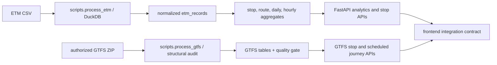

# CrowdWise backend architecture

## Scope and runtime

The repository backend is a Python modular monolith: FastAPI serves read-only analytics and journey queries; DuckDB stores the processed ETM and optional validated GTFS tables; scripts build those tables from immutable source files. Python 3.11+ is supported (workspace verified with 3.12.16). The frontend is independently owned and outside this repository work scope.

## Components

- `app/main.py`: application lifecycle, CORS, request logging, `/health`, `/ready`, and router registration.
- `app/api/routes/`: versioned stop, route, analytics, system and journey endpoints.
- `app/schemas/`: Pydantic request and response contracts.
- `app/data_pipeline/`: ETM/GTFS matching and source metadata helpers.
- `app/routing/`: service calendar evaluation, bounded timetable search and preference ranking.
- `app/services/`: database-backed schedule loading.
- `scripts/process_etm.py`: preserves every source row in normalized transaction records and rebuilds reproducible aggregates.
- `scripts/process_gtfs.py`: validates and transactionally loads an authorized static feed.
- `datasets/`: local raw and processed data (excluded from Git); `outputs/` holds derived reports (also excluded).

## Data flow and evidence boundary

ETM `created_at` remains a transaction timestamp. The ETM pipeline derives ticket-start historical summaries; it does not assert a bus-stop queue, confirmed boarding time, actual alighting, individual bus trip, onboard occupancy or live state. GTFS scheduled search is enabled only when loaded feed quality metadata permits it. An ETM-to-GTFS match must be manually reviewed before linking stop IDs.

The core query path opens a DuckDB connection per request, executes parameterized queries, materializes a small bounded response and closes the connection. Aggregate tables avoid recomputing all 2.56 million raw records for frequent summaries. Performance values are local benchmark observations, not service-level guarantees.

## Failure behavior

Missing processed ETM or required aggregates return HTTP 503. Missing/invalid GTFS produces explicit unavailable capabilities and a structured 503 from journey search. Invalid request parameters return 422; unknown stop identifiers return 404. No missing crowd data is converted to zero crowd.

## Deployment shape

One Uvicorn process serves the monolith and reads a mounted DuckDB file. The container runs as non-root and has a readiness health check. DuckDB is an embedded analytical database; multi-process write concurrency is not a target. Run ingestion as a controlled offline job, then deploy the resulting database read-only where possible. Docker build/runtime still requires verification on a host with Docker installed.

