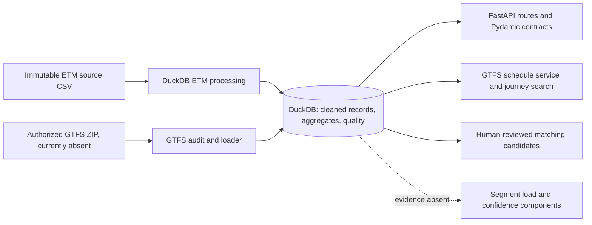

# CrowdWise backend audit

## Follow-up validation (17 November 2026)

The subsequent real-data/scientific-validation pass added a source comparison, obtained a current DTC timetable PDF without treating it as GTFS, repeated ETM benchmarks against the 182,726,656-byte DuckDB, and added controlled synthetic trip-key sensitivity evidence. The suite now has **43 tests passing** (the earlier 38-test suite was extended by five targeted routing/quality/stress tests). The 17 OpenAPI paths were exercised through local Uvicorn: historical/system endpoints returned 200; GTFS map and journey search returned the expected 503 while no GTFS feed is loaded. See [Delhi data acquisition](delhi-data-acquisition-report.md), [trip feasibility](trip-reconstruction-feasibility.md), [crowd feasibility](crowd-estimation-feasibility.md), [API endpoint catalog](api-endpoint-catalog.md) and [performance report](performance-report.md). There is still no authorized GTFS or occupancy ground truth, so those features remain gated unavailable.

**Audit date:** 2026-11-17 (Asia/Kolkata)  
**Scope:** Python backend, ETM/GTFS data, DuckDB, API, tests, scripts and backend documentation. The teammate-owned frontend tree was not inspected or changed.

## Executive finding

The repository contains a functioning ETM-to-DuckDB descriptive analytics pipeline and a FastAPI service. The local database contains the full October 2026 export and is rebuilt with normalized records, stop/route/service profiles, daily/hourly aggregates and append-only pipeline metadata. The system correctly avoids presenting ticket activity as live queue size or verified occupancy. A GTFS parser, candidate matchers and bounded up-to-three-transfer scheduled routing are implemented, but there is **no GTFS archive in this workspace**, so those capabilities have only synthetic test coverage.

The strongest blocking issue is evidence, not Python capability: ETM rows contain no dependable trip identifier, vehicle identifiers are missing for 1,242,167/2,559,899 records (48.5%), and `created_at` is only known to be transaction time. Ticket destinations are not verified alightings. Real segment loads, four-level crowd labels and crowd-aware trip recommendations therefore must remain unavailable.

## Workspace/data audit

- Python environment: project `.venv`; prior runtime verified Python 3.12.16. Dependencies are declared in `requirements.txt` and `pyproject.toml`.
- ETM raw input exists at `datasets/etm/raw/October-Delhi.csv` (290,014,457 bytes) and `October-Delhi.csv.zip` (66,145,093 bytes). The archive also has a small macOS metadata entry; it is not part of the parsed CSV.
- DuckDB exists at `datasets/processed/crowdwise.duckdb` (188,493,824 bytes after final rebuild).
- Tables after this phase's real-data rebuild: `etm_records` (2,559,899), `stop_catalog` (7,148), `stop_demand` (1,718,125), `route_demand` (431,381), `route_stop_catalog` (59,821), `service_profile` (1,396), `daily_demand` (31), `hourly_demand` (744), plus data-quality and run-ledger tables. There are no GTFS tables.
- ETM source observations: October 1–31 2026; 2,753,606 passenger_count sum; 2,559,899 ticket rows; 2,259 normalized route labels; 6,809 usable vehicle values; 7,148 start labels; 6,941 end labels; 1,242,167 null vehicle rows; 0 invalid passenger rows; 0 negative/null amounts; 0 exact nine-field duplicate rows under the existing equality test. Duplicates were not removed.
- The stored stop demand is a ticket-start-label aggregate, not physically observed stop queues.
- GTFS raw/processed directories contain only `.gitkeep`; no feed has been ingested.
- Test suite at audit start has ETM pipeline, API functions, matching candidates, crowd evidence gates, basic schedule search and synthetic end-to-end GTFS tests. Prior recorded result was 29 passing tests.

## Architecture and code review

| Area | Current state | Audit findings / risk |
|---|---|---|
| ETM pipeline | DuckDB import, normalized table, seven derived aggregates, source hash, quality report, append-only run ledger | DuckDB infers source types; report records observed values and retains all rows. Transaction rollback is tested. |
| DuckDB | Single local analytical database | API opens/closes a connection per request. Warm-cache handler benchmarks are recorded in `performance-report.md`; there is no concurrency or production SLA measurement. |
| Stop and route matching | Exact/fuzzy candidates; manual review state | Candidate pipeline is safe against auto-accepting fuzzy suggestions but has no reviewed authoritative crosswalk. Fuzzy text alone cannot resolve ambiguous stop identity or route direction. |
| Trip inference | Explicitly refuses vehicle/time heuristic | Correct conservative policy. Diagnostic gives route-label multiplicity and gaps but not validated trip labels or precision/recall; no ground truth means an accuracy claim is impossible. |
| Segment load | Pure function over a verified trip key and ticket journey bounds | Evidence gate is appropriate. Current routine's interval predicate and counts require edge-case review; it is not connected to real ETM/GTFS data. |
| Confidence/classification | Pure functions with missing-evidence guards | Weighted confidence cutoffs are engineering assumptions, not empirically calibrated; documentation must avoid treating a score as probability. Relative crowd labels require comparable day calibration and are not currently published. |
| GTFS | ZIP structure checks and DuckDB tables | Prior audit covered important core refs and times but omitted duplicate IDs/coordinates/shapes/frequencies/transfers/freshness checks. `CREATE OR REPLACE` must be transaction-safe. Official Delhi documentation warns that static stop times are rough estimates. |
| Routing | Bounded timetable search up to three transfers | Synthetic correctness fixtures exist, but no real Delhi feed. This is not optimized RAPTOR; no arrival-by, walking, frequency service, GTFS transfer rules or trip-specific transfer minimums. |
| API | Versioned stop, route, analytics, system and journey endpoints | Stable response models and docs cover available data. Demand/detail endpoints paginate. No current API for crowd estimates is intentional. |
| Security/deployment | environment-based explicit CORS origins, health/readiness distinction, non-root Dockerfile, consistent DB mount guidance | Local HTTP startup verified; Docker image/runtime not verified because Docker is unavailable. Raw source stays outside image. |
| Tests | Unit and synthetic end-to-end | Need edge tests for ETM hashes, transactions, GTFS optional and malformed files, limits, time handling, ranking semantics, API HTTP serialization and representative performance. |

## Data quality interpretation

Existing quality checks support a descriptive statement that no invalid passenger counts or amounts were found in this file under current field parsing. They do not prove that every original value has the intended business meaning. Zero exact full-row duplicates only says no rows matched on all nine source fields; without a transaction ID it does not establish absence of duplicate ticket events.

The route/start/end unique-label counts reflect normalized strings, not authoritative route IDs, physical stop IDs, directions or public-service variants. `ticket_type_id` semantics and the meaning of `is_ac` need a publisher data dictionary before product-level interpretation.

## Priority risks

1. Real Delhi GTFS unavailable in the workspace and subject to publisher terms/access flow.
2. No trip-level or independent passenger-load ground truth; occupancy validation cannot be performed.
3. Transaction-to-boarding lag unknown; hour-of-day patterns are transaction-hour profiles only.
4. ETM tickets may omit passes, unrecorded riders or other payment channels; coverage bias unknown.
5. Existing GTFS schedule times are officially described as rough estimates, not operational ETAs.
6. Present ranking weights and crowd-confidence score have not been calibrated on user studies/outcomes.
7. Backend can report useful ticket-volume analytics but should not imply crowd-intelligent journey choice until matching/load evidence is available.

## Review method and exclusions

The audit enumerated backend source, scripts, tests, documentation, raw/processed data and DuckDB table schemas/counts. It reviewed API route implementations, Pydantic schemas, GTFS and ETM pipeline code, routing and crowd components, environment configuration and deployment files. No frontend files were read or changed. This is an implementation audit, not a security penetration test or operational agency validation.

