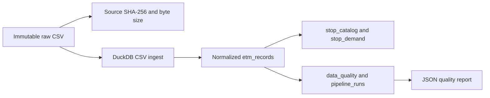

# ETM processing methodology

## Pipeline

**Implementation:** `scripts/process_etm.py`; commands and environment variables are in `README.md`.

1. Confirm the input exists and open a DuckDB transaction.
2. Read CSV with DuckDB type inference and assert all nine expected source headers exist.
3. Normalize source marker strings for route, vehicle and stop labels in the cleaned `etm_records` layer; retain all input rows.
4. Interpret the offset-aware `created_at` as the transaction timestamp. Derive Asia/Kolkata local date/hour/weekday explicitly.
5. Compute data-quality totals, exact-row duplicate investigation, distributions and summary reports. Do not delete duplicate rows.
6. Aggregate stop, route, service-field, daily and date/hour demand tables with separate passenger sum and transaction-row count; create stable opaque start-label keys.
7. Replace current dataset-quality snapshot and append a `pipeline_runs` history row containing SHA-256, bytes, schema/pipeline versions, counts, outcome and runtime.
8. Commit tables as one database transaction; on failure roll back and preserve the previously committed tables. The JSON report is written after commit.

## Repeatability and raw/clean/derived layers

- **Raw:** original source CSV and archive, immutable in `datasets/etm/raw/`; the raw data is not embedded in Git or Docker image.
- **Cleaned:** `etm_records`, one row per source row with conservative string normalization and timestamp-derived fields.
- **Derived:** `stop_catalog`, `stop_demand`, `route_demand`, `route_stop_catalog`, `service_profile`, `daily_demand`, `hourly_demand`, quality/processing metadata and JSON analytics report.
- Every run records source digest and pipeline/schema version. Same source bytes and version should result in the same non-timestamp rows/totals; `generated_at` and report creation time are intentionally run-specific.
- Excluded row count is zero today; if future rules exclude rows, each rule must emit its own count and retained/excluded reconciliation.

## Time aggregation and uncertainty

Dates are based on transaction timestamp after conversion to Asia/Kolkata. Weekday encoding is explicitly Sunday=0. A complete local timestamp month does not prove operational coverage. Descriptive day-type summaries report observed days and can use a day-level percentile bootstrap; serial correlation, holiday calendar and one-month coverage limit inference. No forecasting is currently implemented, so no prediction accuracy is claimed.

## Limitations

Input data dictionary is incomplete. `start_stop_name` is treated as a label, not a verified physical boarding stop. `end_stop_name` is a ticket destination, not confirmed alighting. `route` is a normalized label, not GTFS route identity. `created_at` is transaction time. No trip inference is accepted from vehicle/route/time alone. These constraints block a valid segment occupancy estimator from the current file.
