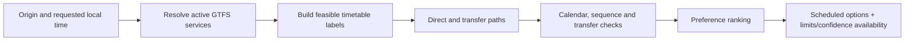

# Routing architecture

## Current algorithm

`app/routing/journey_search.py` uses a bounded, timetable-based earliest-arrival label search with one round per bus boarding. On GTFS load it builds a reusable departure index keyed by boarding stop, sorted by departure second. At each round, feasible later departures are examined; downstream stop labels are relaxed and path objects are materialized only when the earliest-arrival frontier improves or a destination option is found. The index is cached with the loaded feed. A route path is reconstructed using GTFS trip IDs and stop sequences.

Input is validated GTFS schedules/calendars, origin/destination IDs, departure timestamp and maximum 0–3 transfers. Output is a bounded set of earliest-arrival itineraries by boarding count, then preference ranked. The bounded multi-round support is covered with synthetic tests. No real Delhi schedule result has been verified.

## Feasibility rules

- GTFS service must be active on the requested service date after `calendar_dates` additions/removals.
- Board event must not precede the arrival label; inter-vehicle connections use a fixed 300-second buffer.
- A leg follows strictly increasing `stop_sequence` within one trip.
- Arrival must follow departure; a transfer trip must depart after the previous trip arrives plus minimum buffer.
- A trip cannot be boarded twice in the same journey.
- For requests before 06:00, API also examines previous service-day trips whose GTFS times exceed 24:00.
- Frequencies and stop-specific GTFS transfer rules are not yet implemented; an active frequency-based feed is blocked by current importer quality gate.
- Walking transfer connections are not implemented.

## Complexity and limits

Schedule loading creates in-memory trip events and the departure index once and caches them by database file modification time/size. Each query evaluates feasible departures and downstream events up to four boarding rounds. A 16,833-trip/403,992-stop-event synthetic test measured a 138.036 ms warm-query median (5 runs); it does not establish real Delhi latency. Complexity depends on departure density and reached stop events. The current label policy retains one earliest-arrival itinerary per stop per round and may discard slower, lower-crowd prefixes. If crowd data becomes valid, the search must maintain multi-label/Pareto dominance or otherwise prove that crowd-optimal options are retained.

## Algorithm choice

The implementation remains a bounded earliest-arrival label search. RAPTOR is a strong future candidate for round-based multi-criteria transit routing; Connection Scan is another option for sorted connection tables. With no authorized current Delhi feed, replacing a tested engine now would not be validated against actual feed characteristics. The synthetic throughput result supports optimizing the current query/index lifecycle, not claiming routing dominance. Reconsider with feed-size, alternatives-recall, transfer and latency measurements once legitimate feed data is available; see [algorithm comparison](routing-algorithm-comparison.md).

## Time-zone and ETA semantics

Naive request timestamps are interpreted in the agency timezone; aware timestamps are converted. If agency timezone is absent/invalid the implementation falls back to Asia/Kolkata, and the fallback should be surfaced in a future quality response. GTFS scheduled times are approximate schedule values; no real-time predictions or traffic are applied.

